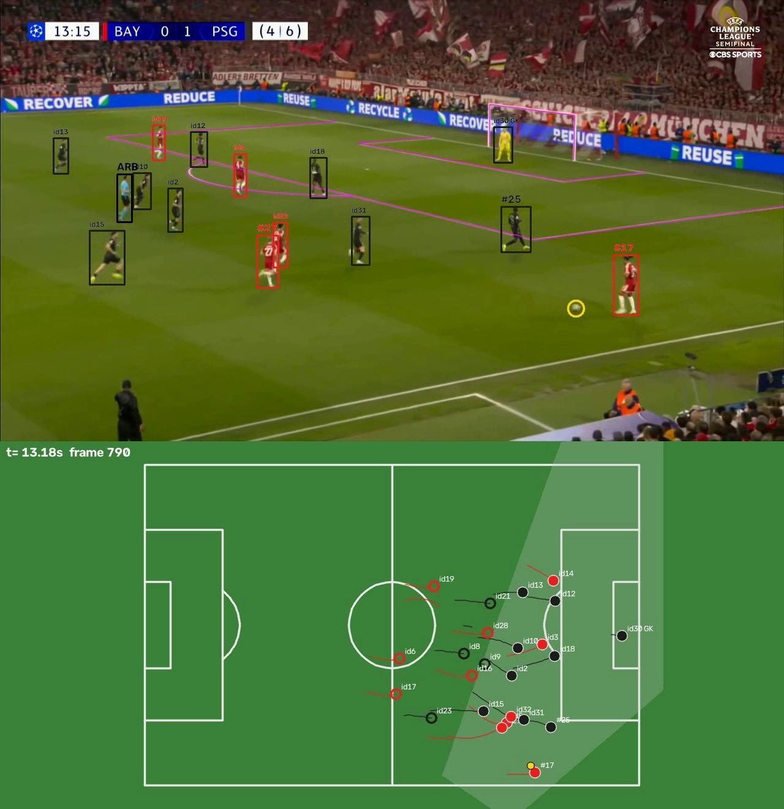
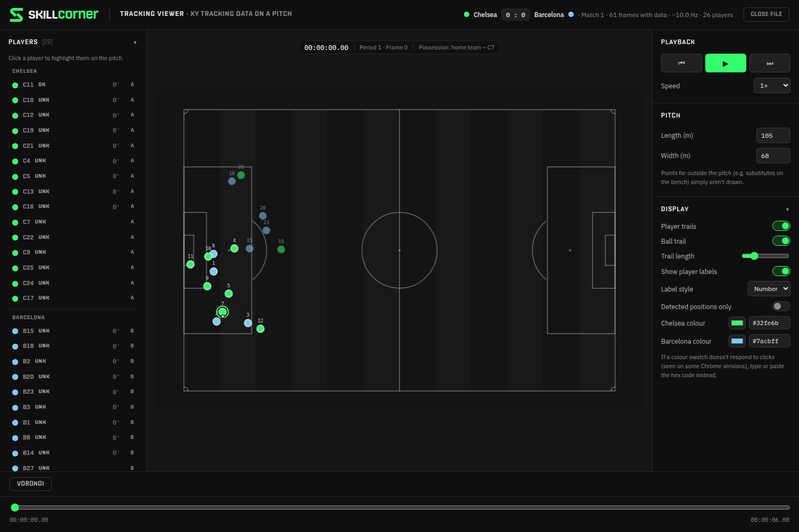

# soccercal — datos de tracking tipo SkillCorner a partir de un vídeo de retransmisión

Metes un vídeo de un partido (la cámara de televisión normal) y obtienes lo mismo que vende
SkillCorner: **la posición en metros de cada jugador y del balón 10 veces por segundo**, con
identidades, equipos, portero, el área que ve la cámara, jugadores fuera de plano extrapolados y
métricas físicas. Los archivos salen **en el formato exacto de SkillCorner**: se abren con su visor
oficial y con [kloppy](https://kloppy.pysport.org).

Funciona en **Google Colab** (gratis, con GPU), en **Jupyter** y en un **MacBook con Anaconda**
(usa la GPU del chip M mediante MPS).

Parte de la calibración del ganador de SoccerNet 2023
([sportlight baseline](https://github.com/NikolasEnt/soccernet-calibration-sportlight/tree/master/baseline)),
cuyos pesos nunca se publicaron: aquí se usan los pesos públicos de NBJW/PnLCalib (misma familia
HRNet, mismo vocabulario de 57 puntos del campo) sobre una implementación propia, y se añade todo lo
que hace falta para llegar a datos de tracking.

---

## Qué obtienes

`soccercal track partido.mp4 -o salida` crea en `salida/`:

| archivo | contenido |
|---|---|
| `1_tracking_extrapolated.jsonl` | **formato SkillCorner**: un fotograma cada 0,1 s con `player_data` (x, y, player_id, is_detected), `ball_data`, `possession`, `image_corners_projection` |
| `1_match.json` | **formato SkillCorner**: equipos, color de camiseta estimado, plantilla (identidades), portero, tamaño del campo |
| `tracking.csv` | lo mismo en tabla: `frame, timestamp, player_id, shirt_number, team, role, x, y, is_detected, speed_kmh, vx, vy` (velocidad en m/s) |
| `ball.csv` | el balón a 10 fps: `x, y, is_detected, kind` (`detected` visto, `interpolated` entre dos detecciones, `carried` en los pies de quien lo lleva) y la posesión |
| `physical.csv` | por jugador: distancia total y por bandas (andar, trotar, correr, HSR 20–25 km/h, sprint >25), velocidad máxima, PSV-99, nº de esfuerzos |
| `cameras.csv` | la cámara en cada fotograma: pan, inclinación, zoom, posición, calidad |
| `verificacion.mp4` | **el control de calidad**: el campo dibujado sobre la imagen + cada jugador con su identidad + minimapa |
| `summary.json` | resumen: % de fotogramas calibrados, identidades por equipo, calidad media |
| `analysis.pkl.gz` | la parte lenta ya calculada; si repites el comando se reutiliza (borra el archivo para rehacerla) |

Coordenadas como SkillCorner: metros, origen en el centro del campo, `x` a lo largo (positivo hacia la
derecha vista desde la cámara principal), `y` a lo ancho (positivo hacia la banda lejana).

### Cómo leer el vídeo de verificación

| lo que ves | significa |
|---|---|
| líneas magenta | el campo dibujado con la cámara calculada: deben caer encima de las líneas reales |
| `#17` | dorsal **leído en la camiseta** (OCR, votado sobre muchas lecturas) |
| `id12` | jugador cuyo dorsal todavía no se ha podido leer: es un número interno de seguimiento, **no** el dorsal |
| `GK`, `ARB`, `JL` | portero, árbitro, juez de línea (árbitros y jueces de línea no salen en los datos de jugadores) |
| sin caja | entrenadores, suplentes, recogepelotas y público: se detectan pero **no** son jugadores |
| círculo amarillo | balón detectado (en el minimapa: relleno = visto, hueco = interpolado o en los pies de quien lo lleva) |
| color de la caja | equipo según el color de la camiseta; un jugador **nunca** cambia de equipo a mitad de clip |
| aviso "PLANO DESCARTADO" | primer plano de un jugador/entrenador, público, banquillo, gráficos: ese tramo **no genera datos** |

Reglas (como SkillCorner): solo se usan planos abiertos de la cámara principal; un plano con una persona
que ocupa más del 40 % de la altura de la imagen, o con poco césped, se descarta. Una persona que pasa la
mayor parte del tiempo fuera de las líneas (banda, banquillo) es *staff*, nunca jugador, y el seguimiento
no puede unirla con un jugador. Un juez de línea es quien vive en la banda **y viste como el árbitro**;
alguien en la banda con otra ropa (entrenador con chaqueta negra, cuarto árbitro con abrigo, suplentes
calentando) es *staff* y no se dibuja.



*Arriba: campo dibujado a partir de la calibración (magenta) e identidades. Abajo: minimapa visto
desde arriba (relleno = visto, hueco = posición estimada, gris = lo que ve la cámara). La estela de
cada jugador es de dónde viene (últimos 2 s; se desvanece hacia el pasado) y la flechita, hacia dónde
va. Ojo: en la tele un movimiento hacia la banda lejana casi no se nota (la profundidad está
comprimida), en el minimapa sí; un jugador que "va de izquierda a derecha" en pantalla puede estar
haciendo una diagonal.*



*La misma salida abierta en el visor oficial de SkillCorner (`SkillCorner/opendata/viz_tools`).*

---

## Opción 1 — Google Colab (lo más fácil, no instalas nada)

1. Abre <https://colab.research.google.com> → *Archivo → Abrir cuaderno → pestaña **GitHub*** y pega
   `https://github.com/delioguzmang-maker/tracking`. Elige `notebooks/00_empezar_aqui.ipynb`.
   **Ábrelo siempre así, desde GitHub**: una copia guardada antes en tu Drive o en "Recientes" es la
   versión vieja del cuaderno.
2. Si ya tenías Colab abierto con una versión anterior: *Entorno de ejecución → **Desconectar y
   eliminar entorno de ejecución***.
3. Menú *Entorno de ejecución → Cambiar tipo de entorno de ejecución → **GPU T4*** → Guardar.
4. **Tu vídeo de Google Drive**: en la celda del paso *3) Procesar* cambia
   `VIDEO_EN_DRIVE = None` por `VIDEO_EN_DRIVE = "trim psg bayern.mp4"` (el nombre exacto del archivo,
   en cualquier carpeta de *Mi unidad*). Colab te pedirá permiso para abrir tu Drive. Si lo dejas en
   `None` se procesa el clip de prueba de 6 s.
5. *Entorno de ejecución → **Ejecutar todas***. La primera celda debe imprimir
   `soccercal 0.4.0 (código …) listo`. Al final verás el vídeo de verificación, las tablas y un zip.

El cuaderno `01_tu_partido.ipynb` es lo mismo con todos los parámetros (tramo, alineaciones…) y la
misma opción `VIDEO_EN_DRIVE`.

**¿Estoy usando la última versión?** La primera celda imprime por ejemplo
`soccercal 0.4.0 (código 1a2b3c4 2026-10-21 10:00) listo`. Cada vez que la ejecutas descarga lo último.
Si ves `0.3.0` o la celda no imprime el código, estás en un cuaderno viejo: repite los pasos 1 y 2.

**Cuando la retransmisión deja de enseñar el campo** (público, banquillo, primer plano de un jugador):
esos fotogramas no se usan para medir nada (el vídeo de verificación lo indica con un aviso), pero los
22 jugadores **siguen en los datos**: su posición se estima a partir de dónde estaban y de cómo se
movía su equipo (`is_detected: false`), y cuando vuelve el plano general cada uno recupera su
identidad. Probado con tu Bayern–PSG al que se le insertaron 1,8 s de público y 1,5 s de primer plano
de #17 en mitad de la jugada: los 20 jugadores vistos antes del corte conservan su identidad después,
durante el corte siguen los 21 en los datos y en el minimapa, y salen 10 + portero (PSG) y 10 (Bayern).

---

## Opción 2 — MacBook Pro con Anaconda, paso a paso

Todo se escribe en la app **Terminal** (Aplicaciones → Utilidades → Terminal). Copia cada bloque,
pégalo y pulsa Enter. Espera a que termine antes de pegar el siguiente.

**Paso 1. Instalar Miniconda** (si ya tienes Anaconda, salta al paso 2).
Descarga el instalador *macOS Apple Silicon (arm64) pkg* de
<https://www.anaconda.com/download/success> (sección Miniconda), ábrelo y sigue el asistente.
Cierra la Terminal y ábrela de nuevo. Debe aparecer `(base)` al principio de la línea.

**Paso 2. Descargar el código**

```bash
cd ~/Documents
git clone -b claude/soccernet-calibration-pkg-r8517j https://github.com/delioguzmang-maker/tracking.git
cd tracking
```

(Si `git` pide instalar las *herramientas de línea de comandos*, acepta y repite el comando.
Alternativa sin git: en GitHub, botón verde *Code → Download ZIP*, descomprímelo en Documentos y
haz `cd ~/Documents/tracking-*`.)

**Paso 3. Crear el entorno e instalar** (unos 5 minutos)

```bash
conda create -n soccercal python=3.11 -y
conda activate soccercal
pip install torch torchvision
pip install -e ".[notebooks,dev]"
```

**Paso 4. Comprobar la instalación**

```bash
soccercal doctor
```

Debe terminar en `Todo listo.` y mostrar `dispositivo = mps` (la GPU del Mac). La primera vez descarga
los pesos (~300 MB). Si algún paso dice `[FALLO]`, mira *Problemas frecuentes* abajo.

**Paso 5. Probar con el clip de ejemplo (6 segundos)**

```bash
soccercal track "$(soccercal sample)" -o salida_demo
open salida_demo/verificacion.mp4
```

Mira el vídeo: **las líneas magenta deben caer encima de las líneas del campo** y cada jugador debe
llevar un número que no cambia. Esa es la prueba de que todo funciona.

**Paso 6. Tu partido.** Empieza SIEMPRE por un tramo corto para ver si tu vídeo va bien:

```bash
soccercal track ~/Downloads/partido.mp4 -o salida_partido --max-seconds 60 --home-name "Local" --away-name "Visitante"
open salida_partido/verificacion.mp4
```

Si se ve bien, el partido entero (el doble de rápido con `--stride 2`, la salida sigue a 10 fps). Los
vídeos de 50/60 fps ya se analizan uno de cada dos fotogramas automáticamente; los fps se miden con las
marcas de tiempo reales del archivo, no con la cabecera, que a veces miente en clips recortados:

```bash
soccercal track ~/Downloads/partido.mp4 -o salida_partido --stride 2 --redo
```

**Paso 7. Jupyter (opcional).** `jupyter lab notebooks/` abre el navegador con los cuadernos
`00_empezar_aqui`, `01_tu_partido` y `02_analisis`.

**Cada vez que abras una Terminal nueva** tienes que hacer `conda activate soccercal` (y `cd` a la
carpeta si vas a usar rutas relativas). Es el error más común.

Desde Python:

```python
import soccercal
res = soccercal.run("partido.mp4", "salida", soccercal.Config(max_seconds=60))
res.table.head()          # posiciones a 10 fps
res.physical              # métricas físicas
```

### Tiempos orientativos

Medido aquí: CPU de 4 núcleos ≈ 1,2 s por fotograma (el clip de 6 s tarda ~3 min). En GPU el coste lo
dominan las dos redes (YOLO11m a 1280 px en cada fotograma analizado; la red del campo 1 de cada 5):
en una T4 de Colab o un Mac M1/M2 Pro espera del orden de 10 fotogramas por segundo, es decir
**unos 1–3 minutos por minuto de vídeo** a 25 fps, la mitad con `--stride 2`. Estas cifras de GPU
son estimaciones, no medidas en este repositorio. Más rápido: `--model yolo11s.pt`.

La **segunda mirada** (balón en alta resolución + dorsales por jugador) añade, medido aquí en CPU con el
clip Bayern–PSG de 14 s, unos 6 minutos: ~3 min para los dorsales (hasta 80 vistas por jugador, así que
no crece con la duración del partido) y el resto para buscar el balón donde faltaba (esto sí crece con
el vídeo; en GPU es rápido). Se hace una sola vez y queda guardada. Para desactivarla:
`Config(ball_refine=False)` o menos vistas con `Config(jersey_views=30)`.

---

## Problemas frecuentes

| síntoma | solución |
|---|---|
| `command not found: soccercal` | no está activado el entorno: `conda activate soccercal` |
| `CERTIFICATE_VERIFY_FAILED` al descargar | ya se usa `certifi`; si persiste: `pip install --upgrade certifi` |
| `doctor` dice `dispositivo = cpu` en un Mac M | `pip install --upgrade torch torchvision` dentro del entorno |
| error de memoria (MPS / CUDA out of memory) | `--batch 2` |
| `pct_frames_with_camera` bajo | el vídeo tiene muchos primeros planos/repeticiones (se descartan a propósito) o no es la cámara principal |
| los equipos salen al revés | `--home-name` / `--away-name` en el orden contrario (el "local" es el primer grupo de color) |
| no se reproduce `verificacion.mp4` en el navegador | ábrelo con QuickTime o VLC (códec mp4v) |
| quieres rehacer el análisis con otro modelo | añade `--redo` |
| el balón se pierde a menudo | ver "El balón" más abajo: con un detector entrenado en fútbol mejora mucho |
| salen etiquetas `id12` en vez de dorsales | el dorsal no se ha visto con claridad (jugador siempre de frente o lejos); con más minutos de vídeo se leen más. Un número dudoso nunca se pone |
| en Colab no cambia nada tras una actualización | ejecuta de nuevo la primera celda y mira la línea `soccercal 0.4.0 (código …)` |

---

## Cómo funciona

```
vídeo ─► [pasada 1: redes, se guarda]  YOLO11 (personas + balón) en cada fotograma
                                       HRNet 57 puntos del campo cada 5 fotogramas
                                       registro del fondo entre fotogramas (flujo óptico)
                                       píxeles de las líneas blancas, color de camisetas
      ─► [pasada 2: segundos]          cámara en cada fotograma ─► jugadores en metros ─► seguimiento
                                       en el campo ─► re-identificación ─► equipos/portero ─► 10 fps
                                       + extrapolación fuera de cámara ─► métricas ─► formato SkillCorner
```

**Calibración (la base de todo).** Puntos clave del campo → homografía RANSAC → focal y pose
iniciales → refinamiento robusto con los puntos (incluidos los largueros a 2,44 m) **más miles de
restricciones densas**: cada línea pintada proyectada debe caer sobre píxeles blancos reales
(transformada de distancia). Luego, por plano, se fija la **posición de la cámara** (va en un trípode:
solo gira y hace zoom) y la calibración de cada fotograma se reduce a 4 parámetros. Entre
fotogramas, el movimiento del fondo da la rotación y el zoom con precisión sub-píxel (modelo de
4 parámetros, no una homografía libre de 8); un suavizador lo fusiona con las calibraciones absolutas.

**Seguimiento en el campo, no en la imagen.** Cada detección es un punto en metros con una
incertidumbre calculada (grande en profundidad para los jugadores lejanos). Filtro de Kalman por
jugador, asociación en dos etapas (estilo ByteTrack) con distancia de Mahalanobis + color de
camiseta, y suavizado RTS. La cámara puede girar lo que quiera: en el campo nadie "se mueve" por ello.
Los jugadores con los pies fuera de la imagen se sitúan por la cabeza (plano a 1,75 m).

**Re-identificación.** Cuando un jugador sale de plano y vuelve, se enlazan los tramos por
cinemática en metros: dónde y a qué velocidad salió, y cuánto se ha desplazado **su equipo** (medido
con los compañeros visibles) mientras no se le veía. Asignación óptima global y un veto de
ambigüedad: si hay dos continuaciones igual de plausibles no se enlaza, porque fusionar mal estropea
a dos jugadores y no fusionar solo parte a uno.

**Equipos, árbitro, portero.** Histograma de color de la camiseta normalizado por el color del
césped (corrige sombra/sol), agrupado en todo el vídeo; una equipación que se parte en dos grupos
(sol y sombra) se sigue reconociendo como el mismo equipo. Portero: la persona de color distinto que
vive junto a una portería; su equipo es el que tiene a sus defensas más cerca de esa portería.

**Segunda mirada (pasada 1b, solo donde falta algo).** Con el primer resultado ya se sabe dónde
buscar:
* *Balón*: en los fotogramas sin balón se vuelve a pasar el detector sobre un recorte alrededor de
  donde debería estar (interpolado entre las detecciones de antes y después), ampliado ~2,4×: un
  balón de 7 px pasa a 17 px. Sin pista cercana, se busca en toda la imagen por teselas.
* *Dorsales*: de cada jugador se eligen sus mejores vistas de todo el clip (las cajas más grandes, sin
  otro jugador delante) y se leen con dos métodos complementarios que vienen dentro del paquete (sin
  descargas): (1) localizar las cifras como manchas claras (u oscuras) que contrastan con el color
  de la camiseta y leer solo ese recorte; (2) detector de texto + reconocedor sobre la espalda
  ampliada y enfocada. Cada identidad vota con todas sus lecturas (un dígito necesita 3 votos, porque
  "7" suele ser medio "17"); un número dudoso no se pone. Dos fragmentos del mismo equipo y dorsal que
  nunca coinciden en pantalla se unen, y dorsales distintos impiden unir.

**Nunca más de 11 por equipo.** Si un equipo tiene más de 10 identidades de campo, algunas son el mismo
jugador visto otra vez: una asignación óptima une los fragmentos (cada tramo recibe un predecesor
posible físicamente, uno de los 10 "huecos" libres o, como último recurso, un hueco extra muy caro),
respetando dorsales y la incertidumbre de posición de los jugadores lejanos. Además, el seguimiento
nunca da a un jugador que ha mostrado la camiseta de un equipo una detección que viste claramente la
del otro: dos jugadores que se cruzan no se intercambian.

**Salida tipo SkillCorner.** Remuestreo a 10 fps; huecos cortos con curva de Hermite; jugadores
fuera de plano movidos con su equipo (`is_detected: false`); una posición extrapolada que la cámara
estaba viendo se descarta (si estuviera ahí, se habría detectado). El balón no visto se interpola
entre detecciones cercanas o se pone en los pies de quien lo lleva (hasta 2 s después de verlo en
sus pies, o 1,5 s antes de reaparecer en los pies de quien luego lo conserva).

---

## Precisión medida

**Calibración en vídeo real** (clip de 6 s, 153 fotogramas, sin verdad de campo: se mide cuánto del
dibujo del campo cae sobre las líneas blancas de la imagen y cuánto vibra la cámara estimada entre
fotogramas; `python tools/calibration_benchmark.py`):

| variante | calibrados | alineación ≤3 px | ≤1 px | vibración pan (°) | inclinación (°) | giro (°) | zoom (log) |
|---|---|---|---|---|---|---|---|
| A. puntos clave fotograma a fotograma (como el baseline / NBJW) | 153/153 | 0,759 | 0,574 | 0,174 | 0,110 | 0,128 | 0,0240 |
| B. + refinamiento denso con las líneas | 153/153 | 0,785 | 0,628 | 0,159 | 0,058 | 0,048 | 0,0199 |
| C. + trípode (posición de cámara fija) | 153/153 | 0,788 | 0,625 | 0,028 | 0,005 | 0,038 | 0,0026 |
| **D. final: red 1 de cada 5 fotogramas + registro + fusión** | 153/153 | **0,788** | **0,633** | **0,014** | **0,003** | **0,004** | **0,0004** |

La versión final dibuja el campo más pegado a las líneas reales y **vibra entre 12 y 60 veces
menos** que calibrar cada fotograma por separado, ejecutando la red del campo 5 veces menos. La
vibración es lo que destroza las velocidades: 0,1° de error en la cámara son decenas de centímetros
en la banda lejana. (La alineación no llega a 1 porque los jugadores y la pintura gastada tapan
parte de las líneas.) Además: decodificar los mapas de calor con el desfase correcto
(etiqueta = `floor(x/2)`) subió la alineación de 0,68 a 0,76 por sí solo.

**Seguimiento con verdad conocida** (`python tools/synthetic_benchmark.py`): trayectorias reales de
22 jugadores (datos abiertos de Metrica Sports) vistas por una cámara simulada que sigue el balón con
paneos y zoom; detecciones con ruido, fallos, oclusiones y falsos positivos; 3 tramos de 1 minuto.

| métrica | resultado |
|---|---|
| pureza de identidad (observaciones asignadas a la persona correcta) | **99,7 %** |
| IDF1 | 0,81 |
| identidades por jugador real en 1 minuto | 2,0 (se fragmenta en vez de mezclar) |
| error de posición, jugadores vistos (calibración perfecta) | 5 cm mediana, 12 cm p90 |
| error de posición, jugadores extrapolados fuera de cámara | 3,8 m mediana, 11,7 m p90 |
| con un error de calibración lento de 0,1° | identidades igual (pureza 99,7 %); posición 21 cm mediana, 50 cm p90 |

El mismo banco sirvió para corregir el diseño: la primera versión (enlace voraz sin compensar el
movimiento del equipo) asignaba mal el 6 % de las observaciones; la actual, el 0,3 %. La
extrapolación siguiendo al equipo bajó el error fuera de cámara de 6,1 m a 3,8 m.

**Balón**, en los fotogramas de salida (10 fps) con cámara válida:

| clip | posición conocida | detectado directamente | muestra revisada a ojo |
|---|---|---|---|
| clip de 1080p, 6 s (Chelsea–Barcelona) | **72 %** | 52 % | todas en el balón o a menos de un diámetro; lo que falta es el disparo de Iniesta (balón en el aire y en la red: sin altura no se puede situar, igual que en SkillCorner) |
| Bayern–PSG original, 720p, 14 s | **84,5 %** | 43 % | todas las posiciones exportadas revisadas a ojo: en el balón o en los pies de quien lo lleva |

El resto está interpolado entre detecciones o en los pies del jugador que lo lleva. Antes de los filtros,
en el Bayern–PSG el "balón" elegido era casi siempre la bota flúor de un jugador, y durante 1,2 s un
punto blanco de las vallas publicitarias (ahora se exige césped por encima del candidato).

**Dorsales en el clip de 1080p** (Chelsea–Barcelona 2009): se leen 33, 26, 35, 3 y 5 del Chelsea y 9 y 10
del Barcelona, coherentes con las alineaciones de aquel partido.

**Dorsales** (Bayern–PSG, 720p): se comprobó a ojo cada jugador. De los 10 cuyo dorsal llega a verse
en algún momento, se leen 7 (Bayern 2, 6, 9, 10, 17, 27; PSG 25), **ninguno equivocado**, y a los otros
10 (siempre de frente o lejos) no se les inventa ninguno. Antes de esta versión se leían 3. Con la
alineación (`home_numbers` / `away_numbers`) se descartan además las lecturas imposibles.

**Identidades** (banco sintético con 22 trayectorias reales de Metrica, 3 partidos de 3 minutos):
50/46/28 identidades → **23/23/23**; IDF1 0,72/0,83/0,93 → **0,96/0,99/0,99**; error de los
jugadores fuera de cámara (mediana) 4,7/2,4/2,8 m → 2,6/2,0/1,8 m. En el Bayern–PSG: 10 + portero del
PSG, 10 del Bayern, y ninguna detección con la camiseta del otro equipo (antes, dos jugadores se
intercambiaban a mitad de clip y salían con el color equivocado).

**Bayern–PSG original** (vídeo de la semifinal, 720p, 59,94 fps aunque la cabecera del archivo dice
52,2: los fps se miden con las marcas de tiempo reales):

* El plano del palco del inicio (6,6 % de los fotogramas) se descarta entero.
* Los dos entrenadores de negro junto a la banda son *staff*: no se dibujan ni salen en los datos.
* El árbitro sale una sola vez, aunque tapado por jugadores lo detectan dos cajas.
* El portero del PSG se asigna al PSG.
* El pase adelantado del segundo 4,7 llega al 10 del Bayern y el balón sigue su conducción hasta el
  segundo 10 (comprobado fotograma a fotograma). Antes el programa aceptaba que el balón "diera media
  vuelta" hasta la bota de un jugador del PSG que se tiraba al suelo, y le daba la posesión al PSG:
  ahora una cadena de detecciones en los pies solo continúa un pase rápido si está en su trayectoria.
* Un balón que se ha visto alejarse más de 3 m de quien lo tenía (pase, centro, despeje) ya no
  "vuelve" a sus pies cuando se pierde en el aire: queda como desconocido. En los clips de SoccerNet
  esto quitaba un centro (SNMOT-141, 1,7 s) y un balón largo (SNMOT-116, 1,3 s) pegados al pie del
  que los golpeó. En los mapas de espacio el anillo de "tiene el balón" solo sale si el balón está
  en sus pies en ese momento.
* Dorsales leídos: 2, 6, 9, 10, 17 y 27 del Bayern y 25 del PSG (todos correctos).
* La calibración cae sobre las líneas reales en todo el clip (círculo central, área, portería).

**Velocidad falsa por el movimiento de la cámara** (Bayern–PSG): el entrenador que está quieto en la
banda, mientras la cámara lo ve y gira hasta 7°/s, sale con 0,3 m/s de mediana y 0,49 m/s como máximo
(posición estable a ±0,3 m). La cámara se calcula en cada fotograma (red cada 5 + registro entre medias),
no se reutiliza la del fotograma calibrado más cercano, que es lo que provoca saltos de casi un metro
y velocidades falsas de 4–7 m/s en otros sistemas. En el control del espacio, 0,49 m/s de error mueven
el punto de reacción de un jugador como mucho 0,35 m (× 0,7 s).

**Identidades con verdad conocida: SoccerNet** (`python tools/soccernet_eval.py`). Tres clips de 30 s del
conjunto de prueba de SoccerNet-Tracking 2023 (retransmisión 1080p, cada jugador marcado con su identidad,
equipo y dorsal; el programa no los vio nunca), pasados por el programa entero:

| clip | IDF1 sin / con apariencia | identidades por jugador | equipo correcto | dorsales bien / mal |
|---|---|---|---|---|
| SNMOT-116 (córner: área llena) | 0,679 / **0,719** | 3,08 / 2,92 | 99,1 % | 15 / 1 |
| SNMOT-126 | 0,951 / **0,951** | 1,41 / 1,41 | 99,9 % | 8 / 1 |
| SNMOT-141 | 0,773 / **0,790** | 2,05 / 1,95 | 99,6 % | 14 / 0 |
| media | 0,801 / **0,820** | | | 37 / 2 |

IDF1 = fracción de las cajas de jugadores atribuidas a la persona correcta durante todo el clip (1 = perfecto).
Lo que más falla son las melés: en el córner, el seguidor salta entre dos compañeros que se tapan durante
1–2 s; cuando no se ven (cajas superpuestas) tampoco hay apariencia que comparar.

**Distinguir a dos compañeros de equipo por su aspecto** (`python tools/reid_benchmark.py`, 4 clips de
prueba de SoccerNet, recortes separados al menos 1 s):

| descriptor | acierto (el más parecido es el mismo jugador) | AUC mismo / otro compañero | AUC detectar un cambio de identidad |
|---|---|---|---|
| color de la camiseta (lo que se usaba) | 39 % | 0,64 | 0,59 |
| OSNet publicado (MSMT17) | 69 % | 0,70 | 0,66 |
| **OSNet ajustado con jugadores de SoccerNet** | **91 %** | **0,90** | **0,91** |

El color separa equipos, no jugadores del mismo equipo. El modelo ajustado (`soccercal/reid.py`,
`tools/train_reid.py`: 27.083 recortes de 1.221 jugadores de otros 57 clips, lotes de compañeros de
equipo) se usa en la segunda pasada: corta un seguimiento cuando la persona cambia mientras un compañero
estaba a menos de 3 m, y une los fragmentos del mismo jugador por su aspecto.

Formato verificado: `tests/test_export.py` carga la salida con kloppy, y el visor oficial
`SkillCorner_Tracking_Viewer.html` la abre sin errores (probado en Chromium: 26 identidades, 61 fotogramas, 10 Hz, portero y posesión).

---

## Análisis táctico: control del espacio y valor (cuaderno `02_analisis`)

Con las posiciones y velocidades se calculan los modelos clásicos de la analítica de fútbol
(`soccercal/tactics.py`). Funcionan sobre los archivos SkillCorner, así que sirven igual con nuestra
salida y con los datos abiertos de SkillCorner:

```python
from soccercal.tactics import Match, plot_control
m = Match.load("salida")          # o Match.from_result(res)
plot_control(m, 56, model="spearman")   # "fernandez", "value", "soccermap"
```

| función | qué calcula | de dónde viene |
|---|---|---|
| `pitch_control` | probabilidad de que el equipo con el balón lo gane si se juega a cada punto | modelo de William Spearman (2018) con el código de Laurie Shaw (LaurieOnTracking, *Friends of Tracking*): mismos parámetros y ecuaciones. Comprobado contra su código original en el Bayern–PSG: **diferencia máxima 1·10⁻¹⁵**, y 34 veces más rápido (38 ms frente a 1,3 s por fotograma) porque calcula todo el campo a la vez. El fuera de juego (`offsides=True`, como Shaw) da los mismos jugadores que su `check_offsides` en los 83 fotogramas probados |
| `space_control` | control del espacio por "zonas de influencia" gaussianas, adelantadas 0,5 s y estiradas en la dirección de carrera, más grandes lejos del balón | Fernández y Bornn, *Wide Open Spaces* (2018): comprobado contra el apéndice del artículo original (ecuaciones 13-21). El radio según la distancia al balón solo existe como figura (Fig. 9): lo hemos ajustado a la figura digitalizada (error 0,05 m); la fórmula `4 + d³/972` de otras implementaciones se separa hasta 0,6 m |
| `soccermap.pass_success`, `plot_control(..., model="soccermap")` | probabilidad de que un pase desde el balón a cada punto salga bien | SoccerMap (Fernández y Bornn, 2020), arquitectura del artículo, **entrenada aquí** en dos fases: primero 269.767 pases de 293 partidos de StatsBomb 360 (jugadores en la imagen, sin velocidades) y después 15.246 pases de 20 partidos abiertos con seguimiento (SkillCorner, IDSSE, Metrica). En 3.869 pases de 5 partidos que no vio: **pérdida logarítmica 0,299 y AUC 0,87**, mejor que la regresión logística con rasgos hechos a mano del propio artículo (0,318 / 0,85) y que predecir siempre la media (0,428 / 0,51); error de calibración 0,02. Sin la fase de StatsBomb se quedaba en 0,341 / 0,81 |
| `space.pitch_value`, `space.space_occupation`, `space.space_generation`, `space.summary` | valor de cada zona según dónde está el balón; ganancia de espacio (SOG, activa / pasiva), pérdida (SOL) y generación de espacio (SGG) por jugador | *Wide Open Spaces*, secciones 4-5, tal como se publicaron. Su "valor del campo" no es una red privada del Barça: el artículo explica cómo entrenarla (influencia de los defensores según el balón) y aquí se ha entrenado igual, con 25.341 situaciones defensivas de partidos abiertos. En 6.715 situaciones de 6 partidos que no vio: error cuadrático 0,0445 (explica el 52 % de la variación), frente a 0,066 de un mapa medio que no mira el balón |
| `impute.complete` | añade a los jugadores que el vídeo no enseña nunca (portero, extremo del otro lado), marcados como deducidos, solo para los mapas | portero: red entrenada con datos abiertos, **3,3 m** de error mediano en partidos no vistos (8,9 m con una posición fija; 6,1 m con "8 m por delante de la portería hacia el balón"); jugador de campo: red que mira la forma de sus compañeros y busca el hueco, **12,6 m** de error mediano (24,9 m en el 10 % peor) frente a 16,1 m (26,5 m) del centro del equipo y 13,4 m (32,2 m) de una biblioteca de 114 formaciones reales; 375 ventanas de 15 s en 5 partidos no vistos (saber qué puesto falta daría 3 m: lo difícil es adivinar el puesto) |
| `value_map`, `epv_at` | control × EPV: dónde un pase sería a la vez seguro y peligroso | superficie EPV de Laurie Shaw (`soccercal/data/EPV_grid.csv`, licencia MIT) |
| `control_series` | % del campo (y de lo que ve la cámara) que controla cada equipo en el tiempo | |
| `render_control_video` | vídeo del mapa de control, un fotograma cada 0,1 s | |
| `to_metrica` | tablas `tracking_home` / `tracking_away` del formato de los tutoriales de Laurie Shaw (`Home_7_x`, `Home_7_vx`, ...) y los porteros, para usar su código tal cual | |
| `soccermap_tensor` | los 13 canales de entrada de SoccerMap (Fernández y Bornn, 2020), para quien quiera entrenar el modelo | canales densos como en un-xPass (KU Leuven) |

Las velocidades (`vx, vy`) se calculan como en Laurie Shaw: un salto de más de 12 m/s es un error de
seguimiento, no un sprint, y no se cuenta (antes se recortaba a 12 m/s y podía sumar un sprint falso).

**Límite de la retransmisión:** la cámara solo ve una parte del campo. Los jugadores fuera de cámara
tienen posición estimada y un jugador que el vídeo no muestra nunca (a menudo un portero) falta. En los
mapas esa zona sale en gris; `control_series` da también el porcentaje solo dentro de la cámara, que es
el fiable. En el Bayern–PSG se ve bien: hasta el segundo 7 las dos medidas coinciden; a partir del 10,
con la jugada en una banda, "todo el campo" da al equipo A un 20–35 % y "dentro de la cámara" un 65–80 %.
La diferencia la ponen las zonas que la cámara no ve.

## En qué se parece a SkillCorner y en qué no (honestamente)

Igual: formato de archivos, sistema de coordenadas, 10 fps, `is_detected`, extrapolación fuera de
cámara, proyección de las esquinas de la imagen, posesión, métricas físicas, descarte de planos que
no son la cámara principal.

Diferente / pendiente:

* **Identidades y dorsales.** SkillCorner conoce la alineación, reconoce dorsales y revisa a mano
  (anuncian ~97 % de identidades correctas). Aquí los dorsales se leen con OCR cuando la espalda del
  jugador es visible y está cerca de la cámara (en el clip de prueba a 720p: 7 de 22 jugadores en 14 s;
  en un partido completo y a 1080p se leen muchos más). Un jugador sin dorsal leído que sale mucho rato
  de plano puede volver con otro `id`: habrá más identidades que jugadores. Con dorsal, los fragmentos se
  unen automáticamente, y desde esta versión también por su aspecto (re-identificación ajustada con
  jugadores de fútbol; IDF1 medio 0,82 en tres clips de SoccerNet, ver "Precisión medida").
* **El balón.** El detector genérico (COCO) ve el balón con poca confianza y confunde botas blancas o
  flúor, cabezas y letras de las vallas. Por eso: se guardan también las detecciones débiles, se exige
  que el candidato esté en el césped, tenga el tamaño de un balón de 22 cm a esa distancia, no esté
  sobre un jugador y no sea de un color saturado, y se elige la trayectoria que se mueve como un balón
  (las botas y los falsos positivos saltan). Un candidato pegado al pie puede ser el balón conducido o
  una bota blanca: solo sirve para unir dos detecciones limpias de la misma trayectoria (una
  conducción), nunca para empezarla. Cuando el balón no se ve pero un jugador lo tiene, se sitúa
  en sus pies (`is_detected: false`). La altura (`z`) no se estima. **Para mejorarlo de verdad** usa un
  detector entrenado en fútbol: `--model ruta/a/modelo_futbol.pt` (cualquier modelo Ultralytics cuyas
  clases se llamen `player`, `goalkeeper`, `referee`, `ball`; se reconocen automáticamente).
* **Repeticiones a cámara lenta desde la cámara principal:** no se detectan (las de otras cámaras sí
  se descartan porque la cámara está en otra posición).
* **Distorsión de lente:** se asume cero (correcto en la cámara principal; no en objetivos gran
  angular).
* La pasada de redes en CPU es lenta; para partidos completos usa GPU (Colab) o el Mac con MPS.

---

## Para desarrolladores

```bash
pytest -q                                  # 67 pruebas, ~30 s, no necesitan pesos
python tools/soccernet_eval.py SNMOT-116 ...   # identidades contra la verdad de SoccerNet
python tools/reid_benchmark.py SNMOT-116 ...   # apariencia: ¿distingue a compañeros de equipo?
python tools/open_data.py                     # datos abiertos (SkillCorner, Metrica, IDSSE) para entrenar
python tools/statsbomb_passes.py              # pases con StatsBomb 360
python tools/train_soccermap.py --extra statsbomb_samples.pkl   # o sin --extra: solo seguimiento
python tools/train_pitch_value.py | train_impute.py | train_reid.py
python tools/synthetic_benchmark.py        # seguimiento con verdad conocida
python tools/calibration_benchmark.py      # calibración en el clip real
python tools/make_notebooks.py             # regenera los cuadernos
```

Código en `soccercal/`: `hrnet.py` (red), `field_model.py` (puntos del campo), `camera.py` /
`calibrate.py` / `lines.py` (calibración), `camtrack.py` / `cameras.py` (cámara en el tiempo),
`detect.py`, `tracker.py`, `stitch.py`, `teams.py`, `players.py` (jugadores), `timeline.py`,
`ball.py`, `physical.py`, `skillcorner.py` (salida), `tactics.py` (control del espacio, EPV),
`viz.py`, `pipeline.py`, `cli.py`.

## Créditos y licencias

* Pesos HRNet: *No Bells, Just Whistles* / *PnLCalib* (M. Gutiérrez-Pérez y A. Agudo), descargados
  en tiempo de ejecución desde sus publicaciones de GitHub; consulta su licencia (GPL-2.0) antes de un
  uso comercial. La arquitectura de `hrnet.py` está escrita desde el artículo de HRNet, no copiada.
* Detector: Ultralytics YOLO11 (AGPL-3.0).
* Clip de ejemplo: repositorio de NBJW. Trayectorias del banco sintético: Metrica Sports sample data.
* Formato y visor: SkillCorner open data.
* Control del espacio: modelo de William Spearman (2018) según la implementación de Laurie Shaw en
  LaurieOnTracking (Friends of Tracking, MIT); superficie EPV `soccercal/data/EPV_grid.csv` de ese mismo
  repositorio (MIT, © 2021 Friends-of-Tracking-Data-FoTD). Influencia de J. Fernández y L. Bornn,
  *Wide Open Spaces* (MIT Sloan 2018); entrada de SoccerMap (Fernández y Bornn, ECML-PKDD 2020), canales
  densos como en un-xPass (DTAI, KU Leuven). El código de `tactics.py` está escrito desde los artículos y
  comprobado contra esas implementaciones, no copiado.
* Modelos entrenados aquí (`soccercal/data`), con datos abiertos que hay que citar: SkillCorner Open Data
  (MIT), Metrica Sports sample data, IDSSE (Bassek et al., *Scientific Data* 2025, CC BY 4.0), StatsBomb
  Open Data (uso libre citando a StatsBomb) y SoccerNet-Tracking 2023 (Cioppa et al., uso para
  investigación). OSNet: Zhou et al. (ICCV 2019), pesos publicados `kaiyangzhou/osnet` (MIT); la
  arquitectura de `reid.py` está escrita desde el diseño publicado y carga esos pesos sin diferencias.
